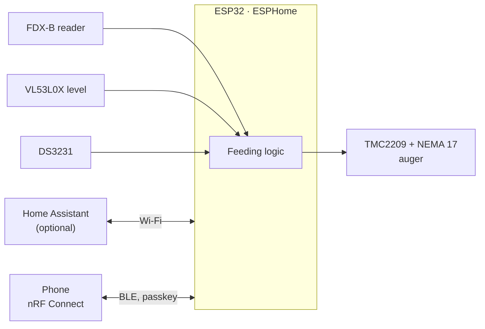

# cat-feeder

Smart cat food dispenser built on **ESP32 + ESPHome**, with optional **Home Assistant** integration.

- Dispenses a configurable portion through a 3D-printed auger driven by a NEMA 17 + TMC2209
- Identifies the cat by its implanted microchip (FDX-B 134.2 kHz)
- Feeds at most once per time slot; manual override (custom portion) from Home Assistant or BLE
- Measures the hopper level with a ToF laser, estimates remaining portions, detects auger jams (StallGuard)
- Modular hopper: stack N identical segments for more capacity
- Silica gel chamber in the lid keeps the kibble crunchy, without touching the food

The device is autonomous: feeding logic runs on the ESP32, configuration persists in flash, and time is kept by SNTP with a DS3231 RTC fallback. Home Assistant (Wi-Fi) and BLE are configuration channels, not requirements.



## Layout

| Path | Content |
|---|---|
| `docs/` | Design plan, BLE configuration guide |
| `firmware/esphome/` | ESPHome configuration and local components (`fdx_b`, `tmc2209_uart`, `ble_passkey`) |
| `hardware/` | Pin map, bill of materials, shopping list |
| `cad/` | Parametric FreeCAD model (`build.py`) and STEP/STL exports |
| `homeassistant/` | Notifications blueprint |

## Status

| Area | State |
|---|---|
| Design | done — [`docs/plan.md`](docs/plan.md) |
| CAD | done, not printed yet — every part fits a 180 × 180 × 180 mm bed |
| Firmware | feeding logic, microchip reader, BLE configuration tested on an ESP32 devkit; TMC2209 driver untested (no hardware yet) |
| Assembly | waiting for parts — [`hardware/shopping-list.md`](hardware/shopping-list.md) |

## Firmware

```bash
cd firmware/esphome
cp secrets.example.yaml secrets.yaml      # fill in Wi-Fi, API key, a random 6-digit BLE passkey
uvx esphome run --device /dev/ttyUSB0 cat-feeder.yaml
```

No OTA: the firmware is flashed over USB. Local configuration over BLE: [`docs/ble-gatt.md`](docs/ble-gatt.md).

## CAD

Parts are generated by [`cad/build.py`](cad/build.py) inside FreeCAD (prefer `freecadcmd` for a full rebuild, the auger sweep is heavy):

```python
exec(open("cad/build.py").read(), {"__file__": "cad/build.py", "SEGMENTS": 2, "EXPORT": True})
```

`SEGMENTS` sets how many hopper segments the assembly uses; `EXPORT` writes STEP + STL to `cad/export/`. Print one `hopper-segment` per segment. Recommended material: PETG.
