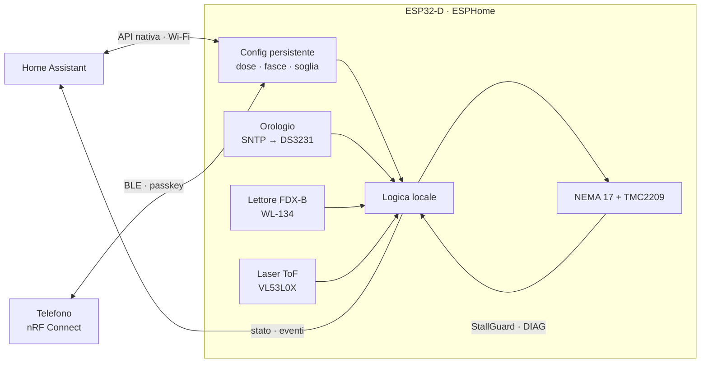
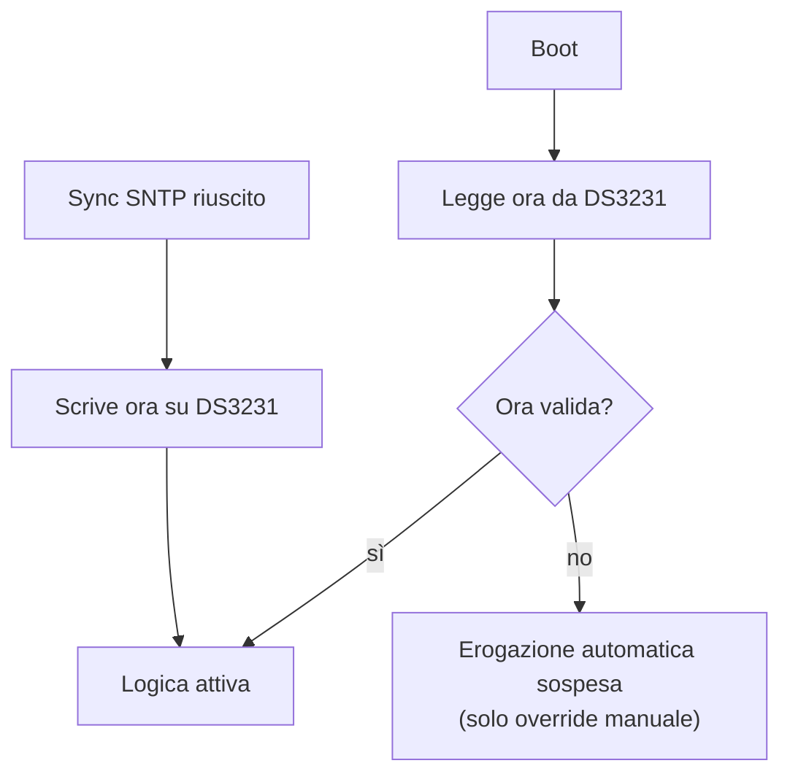
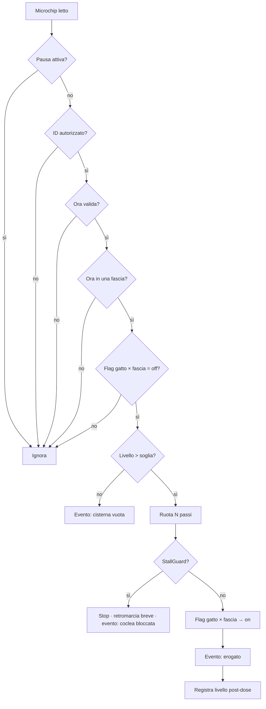

# Piano di progetto — dispenser intelligente per gatto

Ecosistema: **ESP32 + ESPHome**, con **Home Assistant opzionale**. Priorità: affidabilità meccanica e logica locale, per evitare blocchi o falsi rilasci.

## Principi

1. **Il dispositivo è autonomo**: la logica di erogazione gira sull'ESP32, non in HA
2. **Configurazione persistente**: dose, fasce e soglie restano in flash; senza HA vale l'ultima configurazione
3. **Ora sempre valida**: SNTP quando c'è rete, RTC a batteria quando manca
4. **Due canali di configurazione**: HA via Wi-Fi (remoto) e BLE (locale, senza rete)
5. **Niente OTA**: il firmware si aggiorna via USB
6. **Il gatto è riconosciuto dal suo microchip**: niente medaglietta

## Architettura



## Fase 1 — Hardware

| Ruolo | Componente | Bus | Note |
|---|---|---|---|
| MCU | **ESP32-D** (WROOM-32D) | — | già disponibile · Wi-Fi + BLE |
| Orologio | **DS3231** + CR2032 | I²C | ora valida dopo un blackout senza rete |
| Identificazione | lettore **FDX-B 134.2 kHz** (es. **WL-134**) + antenna ad anello | UART | legge il microchip sottocutaneo (ISO 11784/11785) |
| Livello | laser ToF **VL53L0X** | I²C | fascio stretto, adatto a un tubo · nativo in ESPHome |
| Motore | NEMA 17 | — | dosatura volumetrica a passi |
| Driver | **TMC2209** | STEP/DIR + UART + DIAG | silenzioso · StallGuard per il rilevamento del blocco |
| Dosatore | coclea (auger) in tubo, stampata 3D | — | PETG o PLA |
| Alimentazione | alimentatore **12V 2A** + step-down a 5V | — | 12V al TMC2209, 5V a ESP32 e sensori |

Vincoli dell'ESP32 classico da rispettare nel cablaggio:

- GPIO 34–39 **solo input** (vanno bene per DIAG e sensori, non per STEP/DIR/EN)
- strapping pin (0, 2, 5, 12, 15) da evitare per segnali con pull-up/down esterni
- GPIO 6–11 riservati alla flash
- UART: UART0 è la console USB → WL-134 e TMC2209 su UART1/UART2

Assegnazione dei pin: [`hardware/pinout.md`](../hardware/pinout.md).

### Antenna del lettore

| Parametro | Valore |
|---|---|
| Distanza utile | **5–10 cm** dal microchip |
| Posizione del chip nel gatto | tra le scapole / lato del collo |
| Forma | anello attorno all'imbocco della ciotola: il gatto ci infila la testa per mangiare |
| Vicino all'antenna | niente metallo, motore e cavi di potenza lontani (disturbano i 134 kHz) |

## Fase 2 — Firmware ESPHome

### Componenti

| Funzione | Componente ESPHome | Persistenza |
|---|---|---|
| Dose (passi) | `number` (template) | `restore_value: true` |
| Inizio/fine fasce | `datetime` (type `time`, template) | `restore_value: true` |
| Soglia cisterna | `number` (template) | `restore_value: true` |
| ID microchip autorizzati | `globals` array (max N, oggi 1) | `restore_value: true` |
| Flag fasce | `globals` bool **per gatto × fascia** | `restore_value: true` — un riavvio a metà fascia non rieroga |
| Pausa | `switch` (template) | `restore_mode: RESTORE_DEFAULT_OFF` |
| Eroga ora | `button` | — |
| Motore | `stepper` (STEP/DIR) | — |
| Blocco motore | `binary_sensor` su DIAG | — |
| Livello | `vl53l0x` → `sensor` template mm / % | — |
| Microchip | `uart` + parser in `lambda` (frame FDX-B del WL-134) | — |
| Ora | `time: sntp` + `time: ds1307` (compatibile DS3231) | RTC |
| Config locale | `esp32_ble_server` con servizio GATT custom | scrive le stesse entità |

⚠️ Componenti **non nativi** in ESPHome:

- **WL-134**: parser UART da scrivere (frame semplice, poche righe di `lambda`)
- **TMC2209 via UART**: serve per impostare la soglia StallGuard (`SGTHRS`, default 0 = disattivato) e la corrente → componente esterno o scrittura dei registri in `lambda`
- **Passkey BLE statica**: chiamate ESP-IDF in `lambda` / componente esterno

### Orologio



### Logica di erogazione



Reset giornaliero: `on_time` alle **00:00** sul dispositivo, tutti i flag → `off`.

### Fasce orarie (default, modificabili)

| Fascia | Orario |
|---|---|
| 1 — mattina | 06:00 – 11:59 |
| 2 — pomeriggio | 12:00 – 17:59 |
| 3 — sera | 18:00 – 23:59 |

### Più gatti

Oggi **un solo microchip**, ma la struttura è già per N:

- lista di ID autorizzati invece di un ID singolo
- flag di fascia **per gatto**: ogni gatto ha la sua erogazione per fascia
- aggiungere un gatto = aggiungere un ID (da HA o via BLE), senza riscrivere il firmware
- in futuro, eventualmente: dose per gatto

### Dose e verifica col livello

Dose = **numero di passi** del motore. Il livello misurato dal laser chiude il ciclo:

| Funzione | Come |
|---|---|
| Blocco immediato | **StallGuard** del TMC2209 durante la rotazione |
| Erogazione a vuoto | livello **cumulato** su più dosi che non scende come atteso → evento "possibile ostruzione" |
| Calibrazione | mm di calo ÷ passi erogati, media mobile → stima delle **dosi residue** |
| Lettura stabile | mediana di più campioni, a motore fermo e dopo un breve assestamento |

Con il tubo da Ø ~7,4 cm una dose fa calare il livello di **~9 mm**, sopra il rumore del ToF: la verifica è possibile già sulla singola dose, il cumulato la rende robusta.

### Comportamento offline

| Situazione | Comportamento |
|---|---|
| HA non raggiungibile | continua con l'ultima configurazione · **nessun riavvio** |
| Wi-Fi assente | come sopra · ora dal DS3231 · configurazione via BLE |
| Blackout, poi riavvio senza rete | ora dal DS3231, flag ripristinati dalla flash |
| DS3231 non valido e niente SNTP | erogazione automatica sospesa, solo override manuale |

⚠️ Obbligatorio nella config:

```yaml
api:
  reboot_timeout: 0s   # default 15 min: si riavvierebbe senza HA
wifi:
  reboot_timeout: 0s   # default 15 min: si riavvierebbe senza Wi-Fi
```

### Configurazione locale via BLE

- Servizio GATT custom: una caratteristica per parametro (dose, fasce, soglia, pausa, eroga ora) + una di sola lettura per lo stato
- Ogni scrittura aggiorna la stessa entità che vede HA: un'unica fonte di verità
- **Client: nRF Connect** — scrittura diretta delle caratteristiche, niente app da sviluppare
- **Sicurezza: pairing con passkey statica** compilata nel firmware, stampata su un **adesivo** sul dispositivo. Il telefono la chiede al primo collegamento
- Le caratteristiche scrivibili richiedono un collegamento cifrato: senza pairing si legge solo lo stato
- Framework **ESP-IDF**, niente `web_server`: BLE + Wi-Fi sull'ESP32 classico occupano molta RAM

Per rendere usabile nRF Connect: tabella UUID → parametro, con formato dei valori, in `docs/`.

### Aggiornamento firmware

Solo **USB seriale**, niente blocco `ota:`. Compilazione con ESPHome (dashboard o CLI, download manuale del `.bin`); flash via USB dal PC di sviluppo.

## Fase 3 — Home Assistant (opzionale)

Istanza: **esistente**. Ruolo ridotto a **pannello remoto e notifiche**:

- le entità ESPHome (`number`, `datetime`, `switch`, `button`) compaiono da sole in HA: niente helper da creare
- automazioni solo per notifiche sugli eventi del dispositivo (erogato, cisterna vuota, coclea bloccata, ora non valida)
- dashboard: livello cisterna, dosi residue stimate, ultima erogazione, stato flag

## Fase 4 — Meccanica e stampa 3D

### Cisterna

Cilindro **stretto e alto**, perché ogni dose produca un calo di livello ben misurabile. Riferimento: **tubo tipo Pringles**, Ø interno ~7,4 cm.

Ipotesi: dose 15 g ≈ 37 ml (croccantini sfusi ~0,4 kg/L), consumo ~55 g/giorno.

| Altezza utile | Capacità | Calo per dose | Autonomia |
|---|---|---|---|
| **23 cm** (una lattina) | ~1 L · ~400 g | **~8,6 mm** | ~7 giorni |
| 35 cm | ~1,5 L · ~600 g | ~8,6 mm | ~11 giorni |

- Sensore **centrato** sul coperchio: la superficie dei croccantini forma un cono
- ⚠️ **Cono del VL53L0X** (~25°): a 23 cm copre Ø ~10 cm, più del tubo, e vede le pareti. Da validare al banco: interno **opaco e scuro**, sensore centrato; ripiego **VL53L1X** con ROI ristretta
- Imbocco della coclea ≥ **5–6×** la dimensione del croccantino, contro i ponti
- Una lattina vera ha fondo metallico e interno in alluminio: solo come riferimento di misura; il prototipo usa un tubo stampato o in plastica

### Altro

1. **Lettore**: antenna ad anello all'imbocco della ciotola, lontana da motore e metallo
2. **Ciotola** in plastica o ceramica, non metallica
3. **Alimentazione**: 12V 2A, step-down a 5V per la logica

## Decisioni

### Prese

| Data | Decisione |
|---|---|
| 2026-10-20 | MCU: **ESP32-D** (già disponibile) · connettività **Wi-Fi** (Thread/Matter scartati: serve C6/H2 e firmware non ESPHome) |
| 2026-10-20 | Logica sul dispositivo, HA opzionale · istanza HA **esistente** |
| 2026-10-20 | Orologio: SNTP + **RTC DS3231** |
| 2026-10-20 | Niente OTA, firmware via USB |
| 2026-10-20 | Identificazione: **microchip sottocutaneo FDX-B 134.2 kHz** (lettore WL-134) |
| 2026-10-20 | Livello: **laser ToF VL53L0X** (VL53L1X come ripiego, componente esterno) |
| 2026-10-20 | Dose in **passi**, verifica col livello cumulato + **StallGuard** |
| 2026-10-20 | Cisterna: **cilindro Ø ~7,4 cm** (riferimento tubo Pringles), altezza 23–35 cm |
| 2026-10-20 | Config locale: **BLE + nRF Connect**, pairing con **passkey su adesivo** |
| 2026-10-20 | Alimentazione **12V** |
| 2026-10-20 | **Un gatto** per ora, struttura pronta per N |
| 2026-10-20 | Mappa dei pin: [`hardware/pinout.md`](../hardware/pinout.md) |

### Aperte

- [ ] Altezza della cisterna (23 vs 35 cm)
- [ ] VL53L0X nel tubo: da validare al banco
