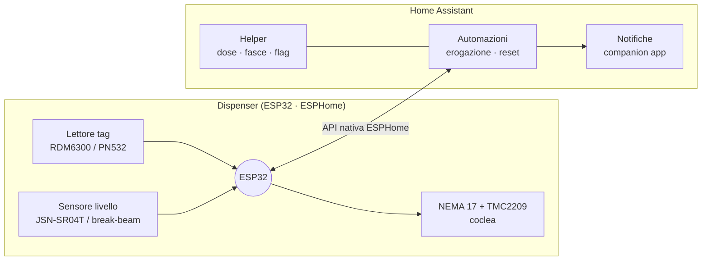
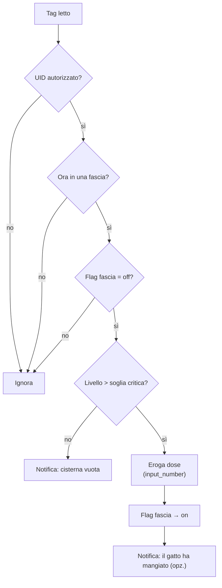

# Piano di progetto — dispenser intelligente per gatto

Ecosistema: **ESP32 + ESPHome + Home Assistant**. Priorità: affidabilità meccanica e logica locale reattiva, per evitare blocchi o falsi rilasci.

## Architettura

Principio: l'ESP32 è un **semplice attuatore/sensore**, la logica di business sta in HA.

## Fase 1 — Hardware

| Ruolo | Componente | Note |
|---|---|---|
| MCU | ESP32 (NodeMCU o ESP32-S3) | Wi-Fi, I/O abbondanti, ESPHome nativo |
| Motore | NEMA 17 | dosatura volumetrica a passi |
| Driver | TMC2209 | silenzioso: il rumore spaventa il gatto |
| Dosatore | coclea (auger) in tubo, stampata 3D | PETG o PLA |
| Identificazione | RFID 125 kHz (**RDM6300**) **oppure** NFC 13.56 MHz (**PN532** + NTAG215) | vedi decisioni aperte |
| Livello | ultrasuoni **HC-SR04** / **JSN-SR04T** (stagno) sul coperchio, **oppure** break-beam IR alla soglia di riserva | vedi decisioni aperte |
| Alimentazione | 5V 3A robusto | picchi del passo-passo |

## Fase 2 — Firmware ESPHome

1. **Stepper**: ruota di N passi/giri su comando da HA (= dose)
2. **Lettore tag**: legge l'UID e pubblica un evento (`event` / `binary_sensor`) verso HA
3. **Livello**: distanza in cm → percentuale di riempimento della cisterna

## Fase 3 — Logica in Home Assistant

### Helper

| Entità | Scopo |
|---|---|
| `input_number.cat_food_portion` | dose (passi o secondi di rotazione) |
| `input_boolean.slot_morning_used` | flag fascia 1 |
| `input_boolean.slot_afternoon_used` | flag fascia 2 |
| `input_boolean.slot_evening_used` | flag fascia 3 |

### Fasce orarie

| Fascia | Orario |
|---|---|
| 1 — mattina | 06:00 – 11:59 |
| 2 — pomeriggio | 12:00 – 17:59 |
| 3 — sera | 18:00 – 23:59 |

00:00 – 05:59: nessuna erogazione.

### Automazione di erogazione

### Reset giornaliero

Automazione alle **00:00**: tutti i flag delle fasce → `off`.

## Fase 4 — Meccanica e stampa 3D

1. **Corpo**: tramoggia (hopper) a imbuto in PETG, per la discesa a gravità dei croccantini senza ponti né blocchi
2. **Lettore**: antenna sotto/attorno alla ciotola in plastica (il metallo scherma), posizionata in modo che il tag si legga solo quando il gatto è in posizione per mangiare
3. **Alimentazione**: 5V 3A, dimensionato sui picchi del motore

## Decisioni aperte

- [ ] **RFID 125 kHz vs NFC 13.56 MHz** — formato e peso della medaglietta sul collare
- [ ] **Ultrasuoni vs break-beam** — percentuale continua vs solo allarme di riserva
- [ ] **Unità della dose** — passi (preciso) vs secondi (semplice)
- [ ] **ESP32 classico vs S3**
- [ ] **Fallback offline** — cosa fa il dispenser se HA non risponde
