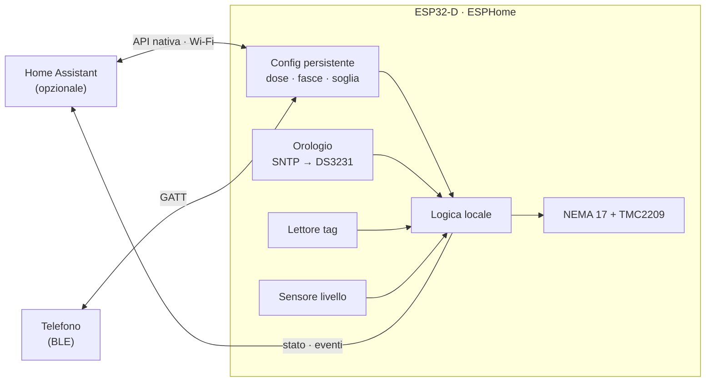
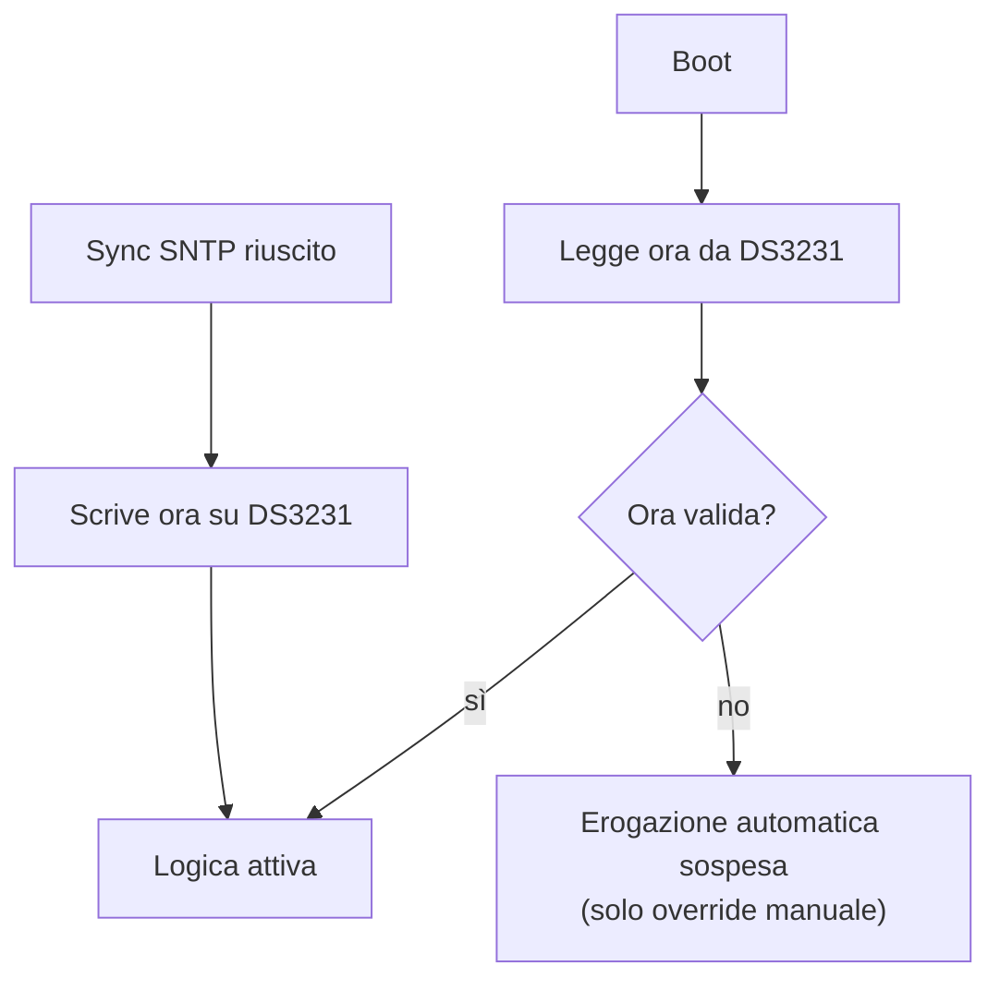
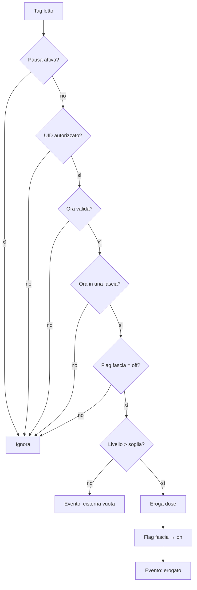

# Piano di progetto — dispenser intelligente per gatto

Ecosistema: **ESP32 + ESPHome**, con **Home Assistant opzionale**. Priorità: affidabilità meccanica e logica locale, per evitare blocchi o falsi rilasci.

## Principi

1. **Il dispositivo è autonomo**: la logica di erogazione gira sull'ESP32, non in HA
2. **Configurazione persistente**: dose, fasce e soglie restano in flash; senza HA vale l'ultima configurazione
3. **Ora sempre valida**: SNTP quando c'è rete, RTC a batteria quando manca
4. **Due canali di configurazione**: HA via Wi-Fi (remoto) e BLE (locale, senza rete)
5. **Niente OTA**: il firmware si aggiorna via USB

## Architettura



## Fase 1 — Hardware

| Ruolo | Componente | Note |
|---|---|---|
| MCU | **ESP32-D** (WROOM-32D) | già disponibile · Wi-Fi + BLE |
| Orologio | **DS3231** + batteria CR2032 | I²C · ora valida dopo un blackout senza rete |
| Motore | NEMA 17 | dosatura volumetrica a passi |
| Driver | TMC2209 | silenzioso: il rumore spaventa il gatto |
| Dosatore | coclea (auger) in tubo, stampata 3D | PETG o PLA |
| Identificazione | RFID 125 kHz (**RDM6300**) **oppure** NFC 13.56 MHz (**PN532** + NTAG215) | vedi decisioni aperte |
| Livello | ultrasuoni **HC-SR04** / **JSN-SR04T** sul coperchio, **oppure** break-beam IR alla soglia di riserva | vedi decisioni aperte |
| Alimentazione | 5V 3A robusto | picchi del passo-passo |

Vincoli dell'ESP32 classico da rispettare nel cablaggio:

- GPIO 34–39 **solo input** (vanno bene per sensori, non per STEP/DIR/EN)
- strapping pin (0, 2, 5, 12, 15) da evitare per segnali con pull-up/down esterni
- GPIO 6–11 riservati alla flash

## Fase 2 — Firmware ESPHome

### Componenti

| Funzione | Componente ESPHome | Persistenza |
|---|---|---|
| Dose | `number` (template) | `restore_value: true` |
| Inizio/fine fasce | `datetime` (type `time`, template) | `restore_value: true` |
| Soglia cisterna | `number` (template) | `restore_value: true` |
| UID autorizzati | `globals` / `text` | `restore_value: true` |
| Flag fasce | `globals` bool × 3 | `restore_value: true` — un riavvio a metà fascia non rieroga |
| Pausa | `switch` (template) | `restore_mode: RESTORE_DEFAULT_OFF` |
| Eroga ora | `button` | — |
| Motore | `stepper` (`a4988` platform, STEP/DIR) | — |
| Livello | `ultrasonic` → `sensor` template % | — |
| Ora | `time: sntp` + `time: ds1307` (compatibile DS3231) | RTC |
| Config locale | `esp32_ble_server` con servizio GATT custom | scrive le stesse entità |

### Orologio



### Logica di erogazione (sul dispositivo)



Reset giornaliero: `on_time` alle **00:00** sul dispositivo, tutti i flag → `off`.

### Fasce orarie (default, modificabili)

| Fascia | Orario |
|---|---|
| 1 — mattina | 06:00 – 11:59 |
| 2 — pomeriggio | 12:00 – 17:59 |
| 3 — sera | 18:00 – 23:59 |

### Comportamento offline

| Situazione | Comportamento |
|---|---|
| HA non raggiungibile | continua con l'ultima configurazione · **nessun riavvio** |
| Wi-Fi assente | come sopra · ora dal DS3231 · configurazione via BLE |
| Blackout, poi riavvio senza rete | ora dal DS3231, flag ripristinati dalla flash |
| DS3231 non valido e niente SNTP | erogazione automatica sospesa, solo override manuale |

⚠️ Obbligatorio nella config:

```yaml
api:
  reboot_timeout: 0s   # default 15 min: si riavvierebbe senza HA
wifi:
  reboot_timeout: 0s   # default 15 min: si riavvierebbe senza Wi-Fi
```

### Configurazione locale via BLE

- Servizio GATT custom con una caratteristica per parametro (dose, fasce, soglia, pausa, eroga ora) + una di sola lettura per lo stato
- Ogni scrittura aggiorna la stessa entità che vede HA: un'unica fonte di verità
- Client: app generica (es. nRF Connect) all'inizio; in seguito pagina **Web Bluetooth** (Chrome Android/desktop, **non** Safari iOS)

Da tenere presente:

- **Sicurezza**: senza pairing chiunque nel raggio BLE può scrivere (anche "eroga ora"). Serve pairing con passkey o almeno un PIN applicativo
- **Memoria**: BLE + Wi-Fi sull'ESP32 classico occupano molta RAM e flash; usare framework **ESP-IDF** e niente `web_server`
- **Coesistenza radio**: Wi-Fi e BLE condividono l'antenna; le prestazioni calano un po', accettabile per questo uso

### Aggiornamento firmware

Solo **USB seriale**, niente blocco `ota:`.

## Fase 3 — Home Assistant (opzionale)

Ruolo ridotto a **pannello remoto e notifiche**:

- le entità ESPHome (`number`, `datetime`, `switch`, `button`) compaiono da sole in HA: niente helper da creare
- automazioni solo per notifiche sugli eventi del dispositivo (erogato, cisterna vuota, ora non valida)
- dashboard: livello cisterna, ultima erogazione, stato flag

## Fase 4 — Meccanica e stampa 3D

1. **Corpo**: tramoggia (hopper) a imbuto in PETG, per la discesa a gravità dei croccantini senza ponti né blocchi
2. **Lettore**: antenna sotto/attorno alla ciotola in plastica (il metallo scherma), posizionata in modo che il tag si legga solo quando il gatto è in posizione per mangiare
3. **Alimentazione**: 5V 3A, dimensionato sui picchi del motore

## Decisioni

### Prese

| Data | Decisione |
|---|---|
| 2026-10-20 | MCU: **ESP32-D** (già disponibile) |
| 2026-10-20 | Logica sul dispositivo, HA opzionale |
| 2026-10-20 | Orologio: SNTP + **RTC DS3231** |
| 2026-10-20 | Configurazione locale via **BLE** |
| 2026-10-20 | Niente OTA, firmware via USB |

### Aperte

- [ ] **RFID 125 kHz vs NFC 13.56 MHz** — formato e peso della medaglietta sul collare
- [ ] **Ultrasuoni vs break-beam** — percentuale continua vs solo allarme di riserva
- [ ] **Unità della dose** — passi (preciso) vs secondi (semplice)
- [ ] **Sicurezza BLE** — pairing con passkey vs PIN applicativo
- [ ] **Client BLE** — app generica vs pagina Web Bluetooth
- [ ] **Istanza HA** — quale usare
