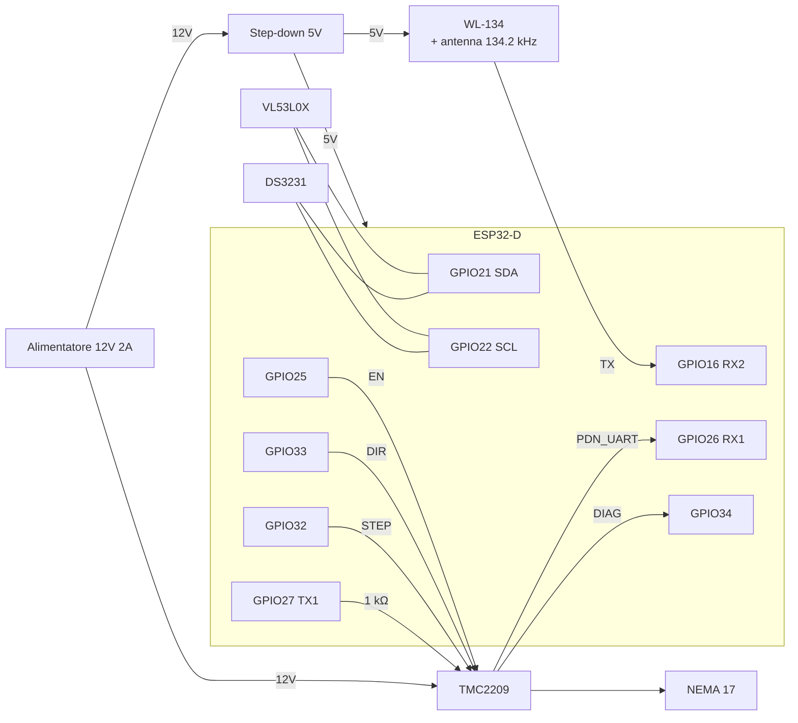

# Mappa dei pin — ESP32-D (WROOM-32D)

Stato: **verificata sulla devkit** (ESP32-WROOM-32D, 4 MB, USB-seriale CH340).

GPIO esposti dalla devkit: 2, 4, 5, 12–19, 21, 22, 23, 25, 26, 27, 32, 33, 34, 35, VP (36), VN (39), TX0 (1), RX0 (3).

## Assegnazione

| Componente | Segnale | GPIO ESP32 | Direzione | Note |
|---|---|---|---|---|
| DS3231 | SDA | 21 | I/O | bus I²C condiviso |
| DS3231 | SCL | 22 | out | bus I²C condiviso |
| VL53L0X | SDA | 21 | I/O | indirizzo 0x29 · DS3231 è 0x68: nessun conflitto |
| VL53L0X | SCL | 22 | out | |
| WL-134 | TX → RX ESP | 16 | in | UART2 · ⚠️ verificare livello: se il modulo esce a 5V serve un partitore |
| TMC2209 | STEP | 32 | out | |
| TMC2209 | DIR | 33 | out | |
| TMC2209 | EN | 25 | out | attivo **basso** |
| TMC2209 | PDN_UART ← TX ESP | 27 | out | UART1 · tramite resistenza **1 kΩ** (UART single-wire) |
| TMC2209 | PDN_UART → RX ESP | 26 | in | UART1 · collegato direttamente a PDN_UART |
| TMC2209 | DIAG | 34 | in | StallGuard · pin solo input, ok |
| — | riserva | 4, 13, 14, 17, 18, 19, 23 | I/O | liberi |
| — | riserva | 35, 36 (VP), 39 (VN) | in | solo input: futuri sensori |
| — | console USB | 1, 3 | — | UART0, lasciato al log |

Pin **evitati**:

| GPIO | Motivo |
|---|---|
| 0, 2, 5, 12, 15 | strapping: influenzano l'avvio |
| 6–11 | flash interna |
| 34–39 | solo input: non usabili per STEP/DIR/EN |

## Alimentazione

| Rail | Sorgente | Utenze |
|---|---|---|
| 12V | alimentatore 12V 2A | TMC2209 `VM` (motore) |
| 5V | step-down da 12V | ESP32 `VIN`, WL-134 |
| 3.3V | regolatore della devkit | DS3231, VL53L0X, TMC2209 `VIO` |

- Condensatore elettrolitico **≥ 100 µF** su `VM` del TMC2209, vicino al driver
- Masse comuni: 12V, 5V e 3.3V con un unico GND
- TMC2209 `MS1`/`MS2` a GND → indirizzo UART 0

## Schema di collegamento

## Da verificare

- [x] Pinout della devkit in uso
- [ ] Livello logico del TX del WL-134 (3.3V o 5V)
- [ ] Corrente del NEMA 17 scelto → `IRUN` del TMC2209 via UART
